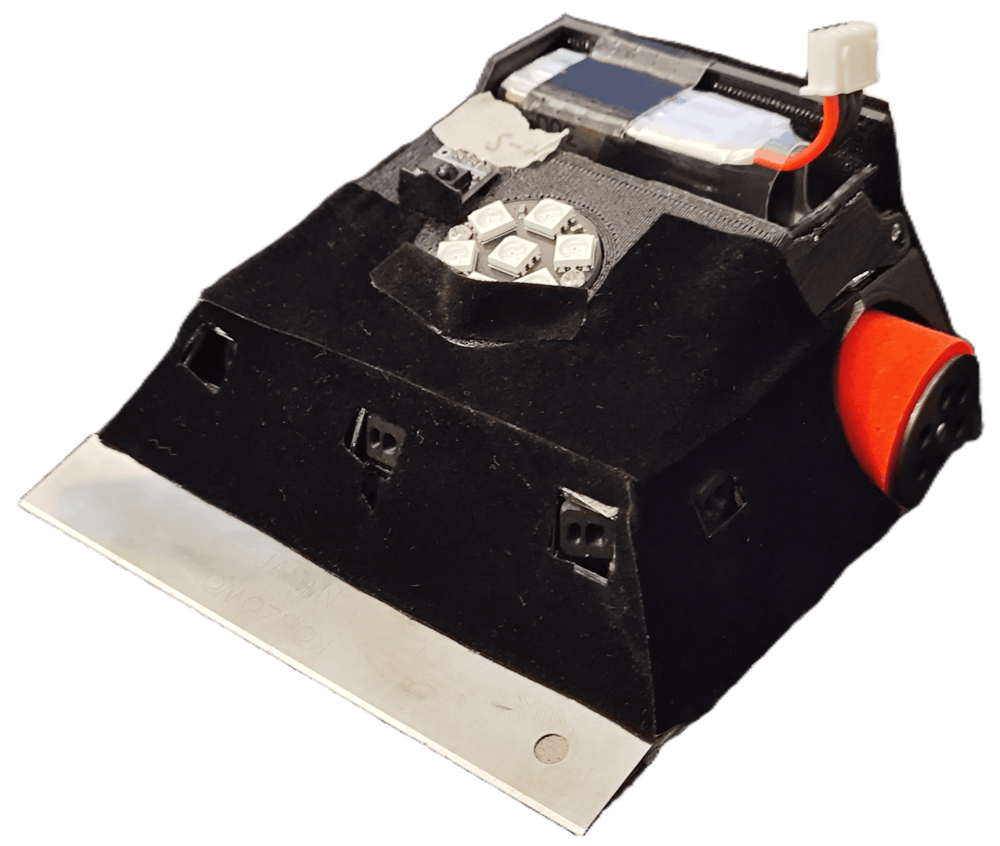

# TAXI — Mini Sumo Robot Firmware

Autonomous mini-sumo (500 g class) combat firmware for a 5× ToF-sensor, 3-line-sensor robot running on the **JSUMO XMotion V3** controller (ATmega32U4, flashed as Arduino Leonardo).



---

## ⚠️ Important Disclaimers

### Not Production-Ready
**This is not a production-ready project.** This codebase is purpose-built for **my specific mini sumo robot** ("TAXI") and its exact hardware configuration. It is not a generic library, framework, or reference design. Pin assignments, sensor layouts, timing constants, and mechanical assumptions are all tailored to this one physical robot. Using this code on different hardware **will not work** without significant modification.

### No Warranty
This software is provided **"AS IS"**, **WITHOUT WARRANTY OF ANY KIND**, express or implied, including but not limited to the warranties of merchantability, fitness for a particular purpose, and noninfringement. In no event shall the authors or copyright holders be liable for any claim, damages, or other liability, whether in an action of contract, tort, or otherwise, arising from, out of, or in connection with the software or the use or other dealings in the software.

**You assume all risk** for any damage to hardware, injury, or competition disqualification resulting from use of this code.

### AI Disclosure
Parts of this codebase (documentation, comments, configuration tables, and some helper scripts) were **generated or assisted by AI** (LLM-based coding agents). All logic has been reviewed, tested on hardware, and validated by me, but AI-generated content may contain subtle errors or non-idiomatic patterns. Treat it as you would any unreviewed contribution.

---

## Repository Structure

```
TAXI/
├── LICENSE                          # GNU GPL v3
├── README.md                        # This file
├── .gitignore                       # Arduino/PlatformIO ignores
├── CONFIGURATIE_REZISTORI_QRE.txt   # QRE1113 resistor config diagram
├── Documentation_guidelines.md      # Internal doc standard for AI agents
├── TAXI_Firmware/                   # Main firmware (current)
│   ├── TAXI_Firmware.ino            # Main sketch
│   ├── Config.h                     # All tunable constants
│   ├── Sensors.h                    # M60F ToF + QRE1113 async state machine
│   ├── Motor.h                      # Motor control (Timer4 PWM fix)
│   ├── StateMachine.h               # Combat FSM (search/attack/evade/backoff)
│   ├── Strategies.h                 # DIP-switch opening tactics
│   ├── StrategyData.h               # Tactic step arrays (8 strategies)
│   ├── RingInfoDisplay.h            # WS2812 LED ring telemetry
│   ├── DistanceSensor.h             # M60F register-level driver
│   ├── LineSensor.h                 # QRE1113 analog reader
│   ├── README.md                    # Detailed firmware documentation
│   ├── TIMERS.md                    # Timer/PWM resource map
│   ├── BUGFIX_VERIFICATION.md       # Side-sensor steering fix log
│   ├── diagram.mmd                  # State machine diagram (Mermaid)
│   └── tools/                       # Strategy designer (HTML/JS)
├── TAXI_Firmware_proto_old/         # Previous iteration (reference only)
├── resources/                       # Test sketches, bench tools, datasheets
│   ├── Bench_Test/                  # Guided M60F tuning wizard
│   ├── TOF_Black_Test/              # Empty-space noise characterization
│   ├── TOF-Distance-sensor-main/    # M60F datasheet & examples
│   ├── XMotionV3-library/           # JSUMO XMotion V3 library (local copy)
│   └── ...                          # Other test harnesses
```

---

## Quick Start (for *this* robot only)

1. **Hardware required** (exact parts):
   - JSUMO XMotion V3 controller
   - 2× JSUMO Core 6V 400 RPM motors + JS2622S wheels
   - 5× SoBotz M60F ToF sensors (half-duplex serial bus on D4)
   - 3× QRE1113 analog line sensors (A1, A2, A4)
   - WS2812B 7-LED ring (A2)
   - NanoLabs MicroStart module (A0)
   - TATTU 3S 11.4 V 300 mAh 75 C LiHV battery
   - Kanzawa ShadowEdge blade + 3D-printed PolyMax Tough PC chassis

2. **Open** `TAXI_Firmware/TAXI_Firmware.ino` in Arduino IDE

3. **Select board**: Arduino Leonardo (`arduino:avr:leonardo`)

4. **Install libraries**:
   - FastLED (Daniel Garcia)
   - SingleWireSerial (JSUMO community — for M60F bus)

5. **Configure** `Config.h` if your hardware differs (pins, thresholds, timings)

6. **Upload** (`Ctrl+U`)

7. **DIP switches** (D5/D6/D7) select 1 of 8 opening strategies at boot.

---

## Key Technical Notes

- **Timer conflict**: M60F bus (`SingleWireSerial`) claims Timer1 (D4 = ICP1), killing `analogWrite()` on D9/D10. Left motor PWM moved to **Timer4 OC4B (D10)** — see `TAXI_Firmware/TIMERS.md`.
- **No PID**: Chase steering is pure proportional on live bearing. PD on bearing rate is a future step.
- **Watchdog armed** (250 ms) in all builds — hung loop reboots board.
- **Reset cause logged** at boot (`MCUSR`): distinguishes brownout vs. watchdog vs. power-on.
- **Any reset mid-round ends the round** — robot enters boot-lock until power-cycled.

---

## License

This project is licensed under the **GNU General Public License v3.0** — see [LICENSE](LICENSE) for full text.

```
TAXI — Mini Sumo Robot Firmware
Copyright (C) 2026 sabinM1

This program is free software: you can redistribute it and/or modify
it under the terms of the GNU General Public License as published by
the Free Software Foundation, either version 3 of the License, or
(at your option) any later version.

This program is distributed in the hope that it will be useful,
but WITHOUT ANY WARRANTY; without even the implied warranty of
MERCHANTABILITY or FITNESS FOR A PARTICULAR PURPOSE.  See the
GNU General Public License for more details.

You should have received a copy of the GNU General Public License
along with this program.  If not, see <https://www.gnu.org/licenses/>.
```

---

## Third-Party Components

| Component | License | Source |
|-----------|---------|--------|
| FastLED | MIT | Daniel Garcia et al. |
| SingleWireSerial | Community/JSUMO | JSUMO GitHub |
| XMotion V3 library | Unknown (JSUMO) | Included in `resources/XMotionV3-library/` |
| M60F register docs | SoBotz | `resources/TOF-Distance-sensor-main/` |

---

## Author

**sabinM1** — [GitHub](https://github.com/sabinM1)

*Built for the TAXI mini sumo robot. Not a general-purpose library.*